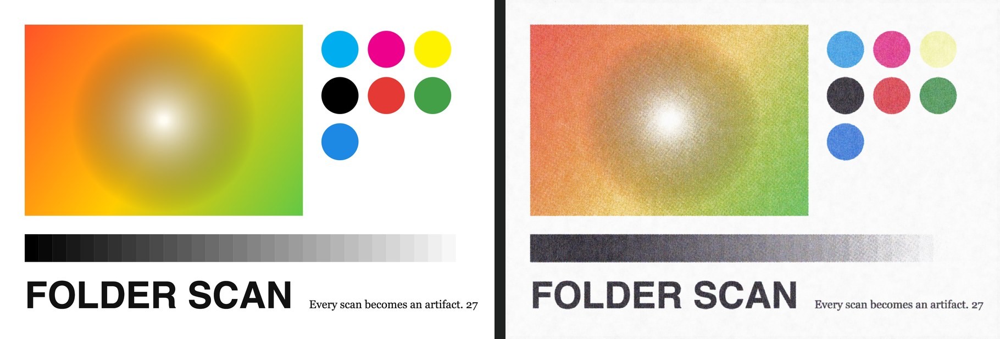
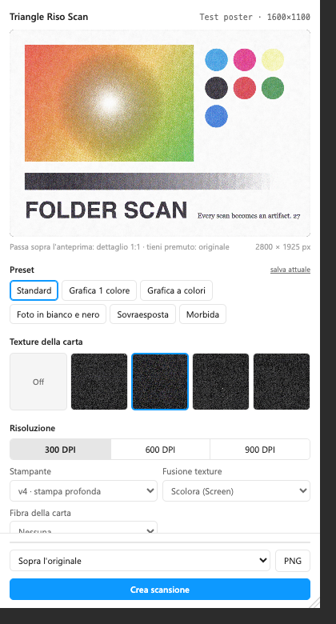
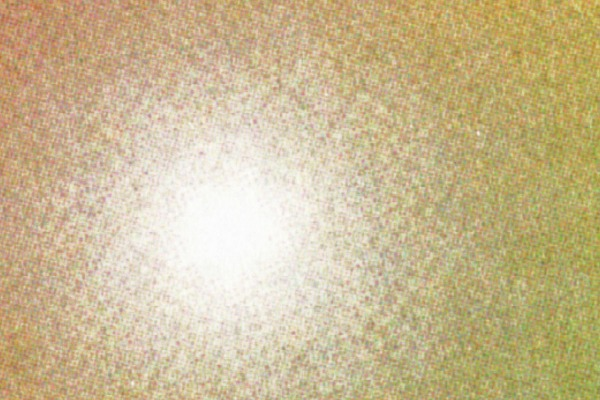

# Triangle Riso Scan — plugin per Figma

Trasforma qualsiasi livello di Figma (frame, immagine, testo, gruppo, componente) in una **stampa scansionata**:
retino a quattro colori, inchiostro, carta, righe dello scanner, polvere e graffi. È l'effetto di
[Folder Scan Machine](https://archivefolder.xyz/scanmachine/) portato dentro Figma, **identico pixel per pixel**,
così lo usiamo nei progetti senza uscire dal file.

<p align="center">
  <a href="https://github.com/TriangleCorporation/triangle-riso-scan/releases/latest/download/triangle-riso-scan.zip">
    
  </a>
</p>

<p align="center"></p>

---

## Indice

- [Installazione](#installazione-2-minuti)
- [Come si usa](#come-si-usa)
- [Tutte le funzioni](#tutte-le-funzioni)
- [Preset e progetti diversi](#preset-in-tutti-i-progetti)
- [Domande frequenti e limiti](#domande-frequenti-e-limiti)
- [Aggiornare il plugin](#aggiornare-il-plugin)
- [Per chi sviluppa](#per-chi-sviluppa)
- [Crediti](#crediti)

---

## Installazione (2 minuti)

Il plugin non è pubblicato sulla Community di Figma: si installa come **plugin di sviluppo**, una volta sola per
computer. Serve l'**app desktop di Figma** (dal browser Figma non permette di importare plugin).

1. **Scarica** lo zip col bottone qui sopra (o da [Releases](https://github.com/TriangleCorporation/triangle-riso-scan/releases))
   e decomprimilo in una cartella che non cancellerai, per esempio `Documenti/Figma plugin/triangle-riso-scan`.
   Figma legge i file da lì ogni volta: se sposti o cancelli la cartella il plugin sparisce.
2. Installa l'app desktop se non ce l'hai: <https://www.figma.com/downloads/> (su Mac anche `brew install --cask figma`).
3. Apri un file di design qualsiasi.
4. Menu **Plugins → Development → Import plugin from manifest…**
5. Scegli il file `manifest.json` dentro la cartella del punto 1.

Fatto: da ora lo trovi in **Plugins → Development → Triangle Riso Scan** in tutti i file del tuo account, anche
quando li apri dal browser. Per rilanciarlo al volo: **⌘ ⌥ P** (ripete l'ultimo plugin) oppure **⌘ /** e scrivi «Riso».

---

## Come si usa

1. **Seleziona** uno o più livelli.
2. Apri **Triangle Riso Scan**: l'anteprima si fa da sola, già alla risoluzione finale.
3. Scegli un **preset**, poi ritocca texture, risoluzione, stampante e cursori. L'anteprima si aggiorna mentre muovi.
4. Premi **Crea scansione**. Il plugin aggiunge il livello **«Scan · nome»** sopra l'originale (o accanto) con
   la scansione come immagine. L'originale resta intatto sotto.

Per ritoccare una scansione già fatta: **seleziona il livello «Scan · …»** (o l'originale), riapri il plugin.
Le impostazioni usate tornano nel pannello e il bottone diventa **Aggiorna scansione**.

<p align="center"></p>

---

## Tutte le funzioni

### Anteprima

| Gesto | Cosa fa |
|---|---|
| Passa il mouse sull'anteprima | Lente in basso a destra con il **dettaglio 1:1** (i punti del retino veri, non ridotti) |
| Tieni premuto sull'anteprima | Mostra l'**originale**, per confrontare |
| Angolo in basso a destra del pannello | Trascina per **ingrandire il pannello** |

Sotto l'anteprima: la dimensione in pixel della scansione. Se supera 4096 px compare «in Figma 4096» (vedi [limiti](#domande-frequenti-e-limiti)).

### Preset

| Preset | Per cosa |
|---|---|
| **Standard** | Il punto di partenza: stampa a colori, retino fitto, texture 2 |
| **Grafica 1 colore** | Grafiche e loghi: tutto in bianco e nero alla fine, un po' di polvere e strisce |
| **Grafica a colori** | Grafiche a colori pulite, gamma più morbida, meno sporco |
| **Foto in bianco e nero** | Fotografie: B/N finale, righe di scansione leggere, texture 1 |
| **Sovraesposta** | Stampante inkjet, inchiostro che sbava, neri pesanti, righe evidenti, bianchi bruciati |
| **Morbida** | Inkjet a 600 DPI, colori spenti, ingrandita al 150%, texture 4 leggera |

Come sul sito originale, i preset di base **non cambiano la texture né la sua opacità** (restano quelle che hai scelto);
«Sovraesposta» cambia solo alcuni cursori. I tuoi preset salvati invece riportano tutto, texture e DPI compresi.

**salva attuale**: salva le impostazioni correnti come preset con un nome tuo; la × sulla pastiglia lo cancella.

### Texture della carta

Cinque riquadri: **Off** e quattro carte scansionate vere (texture 1–4). La texture viene fusa sopra la stampa
con il modo di **Fusione texture** e la forza del cursore **Opacità texture**.

### Risoluzione

| DPI | Lato lungo della scansione | Quando |
|---|---|---|
| **300** | 2800 px × Scala | Uso normale, schermo, social |
| **600** | 3500 px | Stampa, retino più fine rispetto all'immagine |
| **900** | 4500 px | Stampa grande (in Figma arriva a 4096, il PNG resta pieno) |

L'effetto è pensato in pixel (un punto del retino è di pochi pixel): la risoluzione decide quanto il retino si vede.
A 300 DPI il punto è più grosso, a 900 quasi invisibile da lontano.

### Stampante

| Stampante | Carattere |
|---|---|
| **v1 · punti offset** | Retino offset classico, angoli 15/75/0/45° |
| **v2 · grana grossa** | Punti grossi e fuori registro, molto «carta» |
| **v3 · rosetta** | Retino a rosetta regolare, neri più leggeri |
| **v4 · stampa profonda** | Il default: retino fitto e neri densi |
| **v5 · neri laser** | Come v4 ma i neri pieni diventano toner pieno |
| **Inkjet · inchiostro pieno** | Niente punti: inchiostro continuo che può sbavare di lato |

### Fusione texture

**Scolora (Screen)** è il default: la carta schiarisce. Poi **Schiarisci**, **Aggiungi**, **Sovrapponi**,
**Moltiplica** (la carta scurisce) e **Solo texture** (si vede solo la carta, utile per controllarla).

### Fibra della carta

Rumore di carta generato (oltre alla texture): **Nessuna**, **C1 carta morbida**, **C2 grana fine**, **C3 bande a nuvola**.

### Interruttori

- **Fotocopia B/N**: soglia secca, come una fotocopiatrice. Il cursore **Soglia** decide dove si taglia il bianco dal nero.
- **Bianco e nero finale**: converte in grigi tutta la scansione finita, compresi i bordi colorati del retino e la carta.
  Succede anche portando **Vividezza** a −100.

### Regolazioni (21 cursori)

Doppio clic sul nome di un cursore = torna al valore di partenza. Il nome diventa scuro quando il valore è diverso
da quello di partenza. Il numero a destra si può scrivere a mano.

| Gruppo | Cursore | Cosa fa |
|---|---|---|
| Immagine | **Contrasto** | Contrasto prima della stampa (126 = default) |
| | **Luminosità** / **Luminanza** | Schiariscono o scuriscono prima della stampa (si sommano) |
| | **Vividezza** | Saturazione intelligente: −100 = bianco e nero |
| | **Neri grigi** | Alza i neri verso il grigio, come una stampa slavata |
| | **Soglia (B/N)** | Solo con «Fotocopia B/N»: dove si taglia |
| Stampa | **Retino 4 colori** | Quanto pesa la stampa CMYK: 0 = niente retino, 100 = retino pieno e fitto |
| | **Sbavatura inchiostro** | Solo inkjet: l'inchiostro scivola di lato |
| | **Neri di stampa** | Neri più pesanti e pressati |
| | **Mini print** | Ristampa in piccolo e riscansione: ammorbidisce il retino come una copia di una copia |
| Esposizione | **Esposizione**, **Offset**, **Gamma** | La curva dello scanner, come «Esposizione» di Photoshop |
| | **Sfocatura** | Morbidezza dello scanner |
| Scanner | **Rumore e polvere** | Grana, puntini e graffi |
| | **Righe di scansione** | Righe orizzontali scure e chiare |
| | **Strisce dello scanner** | Bande verticali di lampada irregolare e righe sottili di trascinamento |
| | **Distorsione** | Il foglio che si muove durante la scansione (fasce spostate) |
| Carta | **Scala** | 50–150%: a 300 DPI cambia la dimensione della scansione, a 600/900 quanto è ingrandita l'immagine sulla carta |
| | **Opacità texture** | Forza della texture della carta |
| | **Pulizia dei bianchi** | Ripulisce le macchie della carta solo nelle zone chiare |

**Torna a Standard** riporta tutto all'inizio.

### Applicare in Figma

| Opzione | Cosa fa |
|---|---|
| **Sopra l'originale** | Il livello «Scan · nome» va subito sopra l'originale, stessa posizione e dimensione. Dentro gli auto-layout è in posizione assoluta, così non sposta niente |
| **Accanto all'originale** | Stessa cosa, 40 px a destra: comodo per confrontare |
| **Crea scansione / Aggiorna scansione** | Se l'originale ha già la sua scansione, la aggiorna invece di farne un'altra |
| **Applica a N livelli** | Con più livelli selezionati, li scansiona tutti con le stesse impostazioni |
| **PNG** | Scarica la scansione a risoluzione piena (anche oltre i 4096 px di Figma) |

La scansione ricorda le sue impostazioni e il suo originale: se **cambi l'originale** (testo, colori, foto),
seleziona la scansione e premi **Aggiorna scansione**.

---

## Preset in tutti i progetti

- I **preset salvati** e le **ultime impostazioni** stanno nel tuo Figma, non nel file: li ritrovi in ogni file e progetto.
- Le **impostazioni di ogni scansione** stanno dentro il livello: chiunque del team apra il file e abbia il plugin
  può selezionarla e rifarla uguale.
- Per **passare un preset a un collega**: apri «Preset in JSON», premi **Copia l'attuale**, mandagli il testo;
  lui lo incolla nello stesso riquadro e preme **Importa**. Funzionano anche i preset esportati dal sito
  Folder Scan Machine (pulsante di salvataggio dei preset sul sito).

---

## Domande frequenti e limiti

**Perché l'anteprima ha delle righe strane (moiré)?** È il retino rimpicciolito nel pannello. Guarda la lente 1:1
o il livello in Figma a zoom 100%: lì è pulito.

**Figma dice che l'immagine è ridotta / la scansione è meno nitida a 900 DPI.** Figma tiene le immagini al massimo
a 4096 px di lato. Il plugin la riduce lui con buona qualità; per la stampa usa il bottone **PNG**, che resta pieno.

**Il livello è ruotato.** La scansione esce dritta, sul riquadro che contiene il livello ruotato.

**Con molti livelli è lento?** Ogni scansione a 300 DPI richiede circa un secondo, a 900 DPI qualche secondo.
Il file in Figma cresce: ogni scansione è un PNG di 5–15 MB.

**Lo trovo anche dal browser?** Una volta importato dall'app desktop sì, ma il computer deve avere ancora la
cartella del plugin. Su un altro computer va importato di nuovo.

**Errore «L'originale di questa scansione è stato cancellato».** La scansione resta, ma non si può più rifare:
seleziona un altro livello e creane una nuova.

---

## Aggiornare il plugin

Scarica il nuovo zip e **sostituisci i file nella stessa cartella**: Figma prende la nuova versione alla prossima
apertura, senza reimportare. Se cambi cartella: **Plugins → Development → Manage plugins in development**,
rimuovi il vecchio e importa di nuovo il `manifest.json`.

---

## Per chi sviluppa

```
manifest.json        il plugin per Figma (punta a code.js e dist/ui.html)
code.js              lato documento: esporta il livello, crea/aggiorna «Scan · …», pluginData, clientStorage
src/shaders.js       gli shader WebGL2 di Folder Scan Machine, copiati senza modifiche
src/engine.js        la pipeline: random()/noise() di p5 con gli stessi seed, geometria DPI, tile, segni vettoriali
src/presets.js       cursori, preset, regole di applicazione (come applyPreset() del sito)
src/ui.html, ui.js   il pannello
assets/              le quattro texture della carta
build.mjs            costruisce dist/ui.html (un file solo, texture dentro in base64: Figma vuole così)
test/                finto Figma per provare il pannello in Chrome e confronto col sito vero
```

Comandi (Node 18+):

```bash
npm install                    # solo per i test (puppeteer-core)
npm run build                  # rifà dist/ui.html dopo ogni modifica in src/
npm test                       # build + prova del pannello in Chrome headless (immagini in test/out/)
node test/compare-site.mjs     # stessa immagine nel sito vero e nel plugin: differenza pixel per pixel
npm run pack                   # triangle-riso-scan.zip per una nuova release
```

Pubblicare una versione per il team:

```bash
npm run pack
gh release create v1.x.y triangle-riso-scan.zip --title "Triangle Riso Scan 1.x.y" --notes "cosa cambia"
```

Il bottone «Scarica» del README punta sempre all'ultima release.

Come funziona il render: il livello viene esportato in PNG alla risoluzione che serve, il pannello (che ha WebGL2)
fa la pipeline del sito in tile da 1024 px: base (contrasto, grana, fibra) → stampa (retino CMYK o inkjet) →
mini print → curva di esposizione → sfocatura → distorsione, poi righe, strisce, bordo e polvere sul canvas 2D,
poi la finitura (fibra, texture, pulizia dei bianchi, B/N). Il risultato torna a Figma come immagine di riempimento.
Verificato il 03/11/2026: sulla stessa immagine il plugin e il sito differiscono in media di 0,00002 livelli su 255.

<p align="center"></p>

---

## Crediti

Effetto, shader e texture della carta sono di **[Folder Scan Machine](https://archivefolder.xyz/scanmachine/)**
(archivefolder.xyz). Questo plugin ne è un adattamento per uso interno di Triangle Corporation: non va pubblicato
sulla Community di Figma né distribuito fuori dal team senza il permesso degli autori (e senza sostituire le texture).

Plugin: Triangle Corporation · [trngl.it](https://trngl.it)
